<p align="center">
  
</p>

<h1 align="center">Valheim Server Manager</h1>

<p align="center">
  <b>Install, configure, run, mod and protect Valheim dedicated servers on Windows – no batch files, no SteamCMD, no guesswork.</b><br>
  World modifiers · Crossplay & join codes · BepInEx + Thunderstore mods · Live players · World rollback · Backups · UPnP
</p>

<p align="center">
  <a href="https://github.com/clawdroppin/Valheim_ServerManager/releases/latest"></a>
  <a href="https://github.com/clawdroppin/Valheim_ServerManager/releases"></a>
  
  <a href="LICENSE"></a>
</p>

<p align="center">
  <a href="https://github.com/clawdroppin/Valheim_ServerManager/releases/latest"><b>⬇ Download</b></a> ·
  <a href="https://clawdroppin.github.io/Valheim_ServerManager/"><b>🌐 Website</b></a> ·
  <a href="docs/USER_GUIDE.md"><b>📖 User guide</b></a> ·
  <a href="CHANGELOG.md"><b>📝 What's new</b></a> ·
  <a href="#-troubleshooting"><b>🛠 Troubleshooting</b></a> ·
  <a href="AGENTS.md"><b>🤖 For developers & AI agents</b></a>
</p>

<p align="center">
  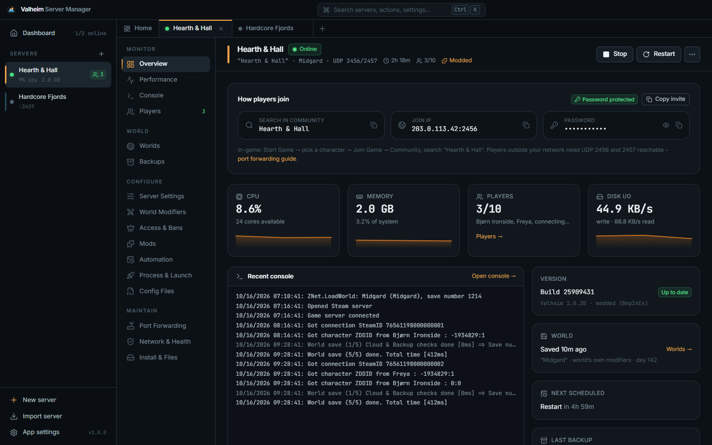
</p>

---

## ✨ Why this manager

<table>
<tr>
<td width="50%" valign="top">

### 🔥 A server in one minute
A wizard picks a free port pair, checks your password against the server's own rules, lets you pick a world-modifier preset and downloads the server through **SteamCMD** – no Steam account needed. Press Start and the world is up within a minute.

</td>
<td width="50%" valign="top">

### ⚔️ World modifiers without switches
Iron Gate's presets – **Casual, Easy, Hard, Hardcore, Immersive, Hammer** – as cards, plus combat, death penalty, resources, raids and portals, and the **no map / no build cost / passive enemies** rules. Save your own sets and reuse them on any server.

</td>
</tr>
<tr>
<td valign="top">

### 🧩 Mods in two clicks
Paste a **Thunderstore** link – BepInEx and every dependency are installed for you. Switch mods on and off, update them, edit their configs with history, read the BepInEx log, or start the server vanilla with one toggle.

</td>
<td valign="top">

### 🌍 Worlds you can't lose
See every world's **seed, day and modifiers**, roll back to the server's own backups, rename and duplicate worlds safely (the name inside the save is rewritten too) and **bring your single-player world** over in one click. Zip backups run on an interval, on stop and before updates – and can be verified.

</td>
</tr>
<tr>
<td valign="top">

### 👥 Know who's playing
Live player count straight from the server (Steam query), names and SteamIDs from the log, **deaths**, session history with play time, and admin / ban / **allow lists** edited safely next to the in-game `ban` commands.

</td>
<td valign="top">

### 🤖 Hands-off hosting
Crash recovery that stops on start-up errors instead of looping, schedules, auto-update that **waits for players to leave**, stop-when-empty, memory/uptime limits, tray mode, start with Windows, Windows toasts and Discord/Slack webhooks. Servers keep running when the app closes.

</td>
</tr>
</table>

### And much more
- **Crossplay:** one switch for Xbox / Game Pass players – the **join code** appears on the Overview as soon as the server registers it
- **Share in one click:** *Copy invite* (name, address, join code, password), a *mod list for players* with Thunderstore links, and any world's seed on a map viewer
- **Get found:** one-click **UPnP**, router-by-router guide, **Windows Firewall** fix (including the hidden “Block” rules), double-NAT / **CGNAT** detection and an automatic *“does Steam list my server?”* check
- **Performance:** live CPU, memory, disk, network and per-core charts plus **24 h / 7 d / 30 d history** of players and resources, and an activity timeline
- **Health check** for files, settings, the world, ports, firewall, mods, RAM, disk, version, Steam listing and log errors – with a fix button for each, plus an A2S query tool
- **Several servers** side by side in tabs, **Start all / Stop all** from the tray, **Ctrl+K** command palette, duplicate servers, portable `.valheim` server packs, adopt existing installs (settings are read from your start script)
- **Privacy:** passwords and webhooks are encrypted at rest (Windows DPAPI); **streamer mode** hides IPs, passwords, join codes and player ids
- **Nothing is ever lost:** rollbacks, restores, imports, renames, resets and mod removals keep a copy first

## 📸 Screenshots

| | |
|:---:|:---:|
| 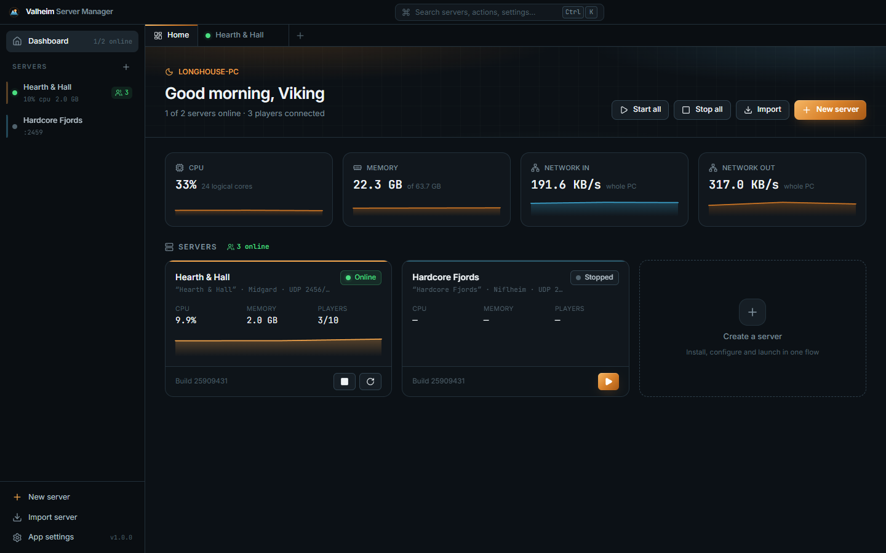 <br> **Dashboard** – every server at a glance | 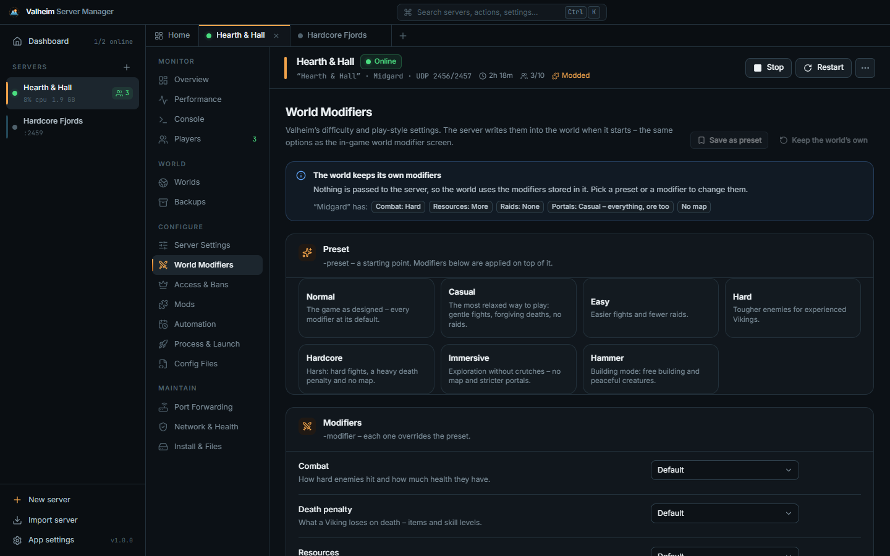 <br> **World modifiers** – presets, modifiers, rules |
| 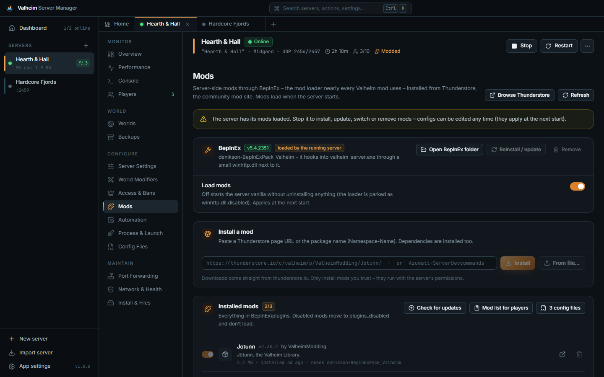 <br> **Mods** – BepInEx and Thunderstore | 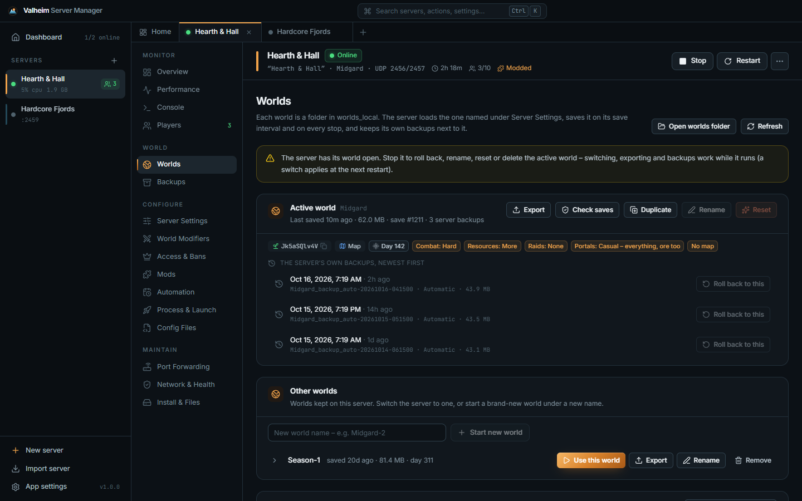 <br> **Worlds** – seed, day, rollback, import |
| 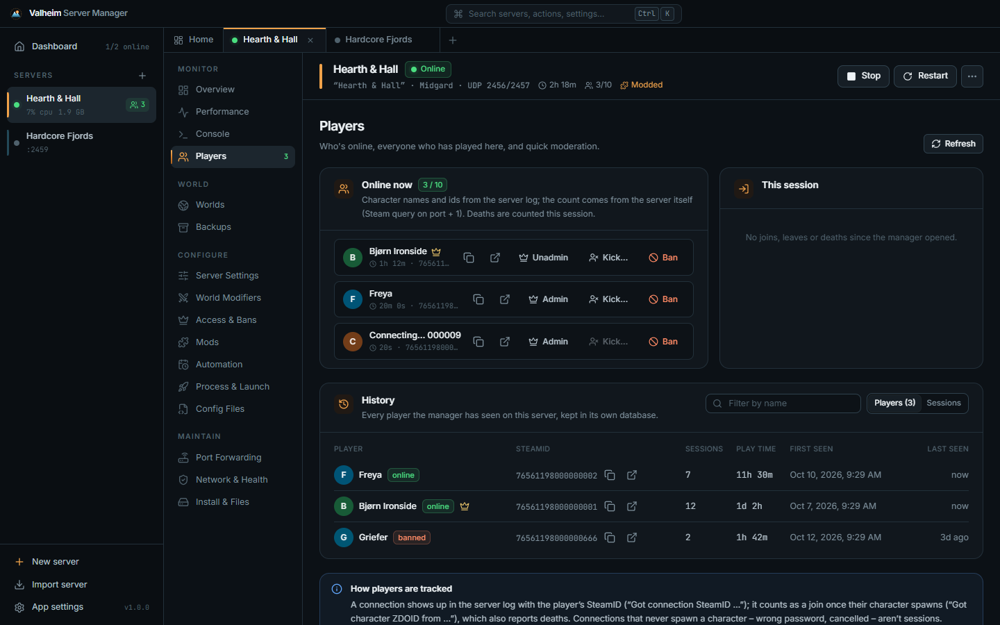 <br> **Players** – online, deaths, history | 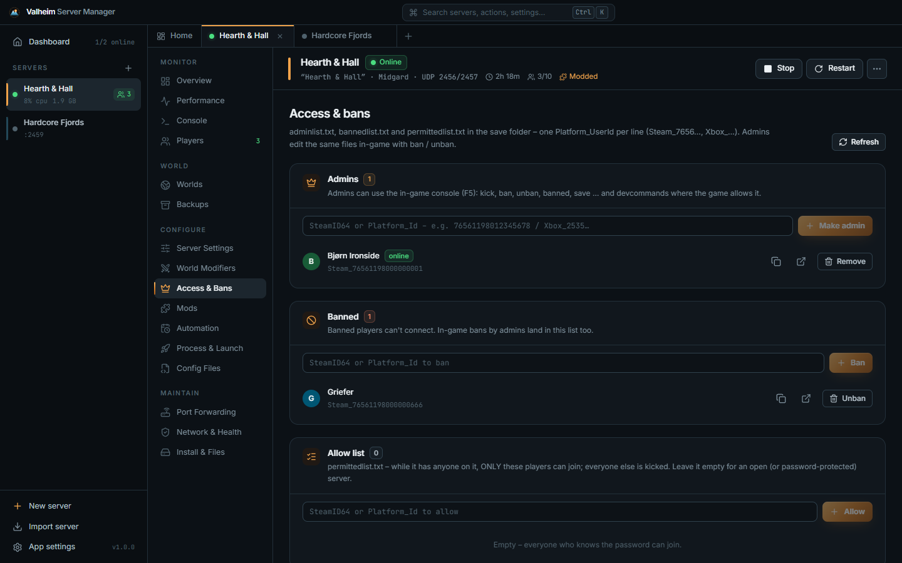 <br> **Access & bans** – admins, bans, allow list |
| 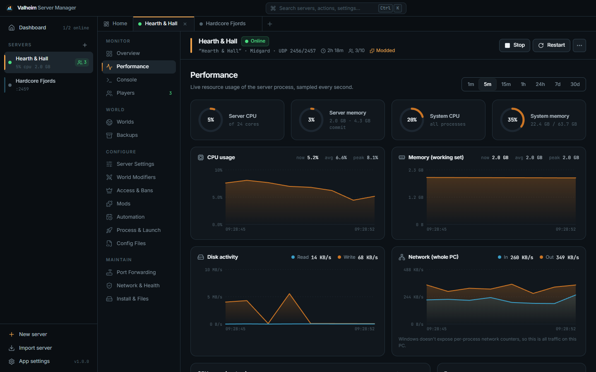 <br> **Performance** – live charts and history | 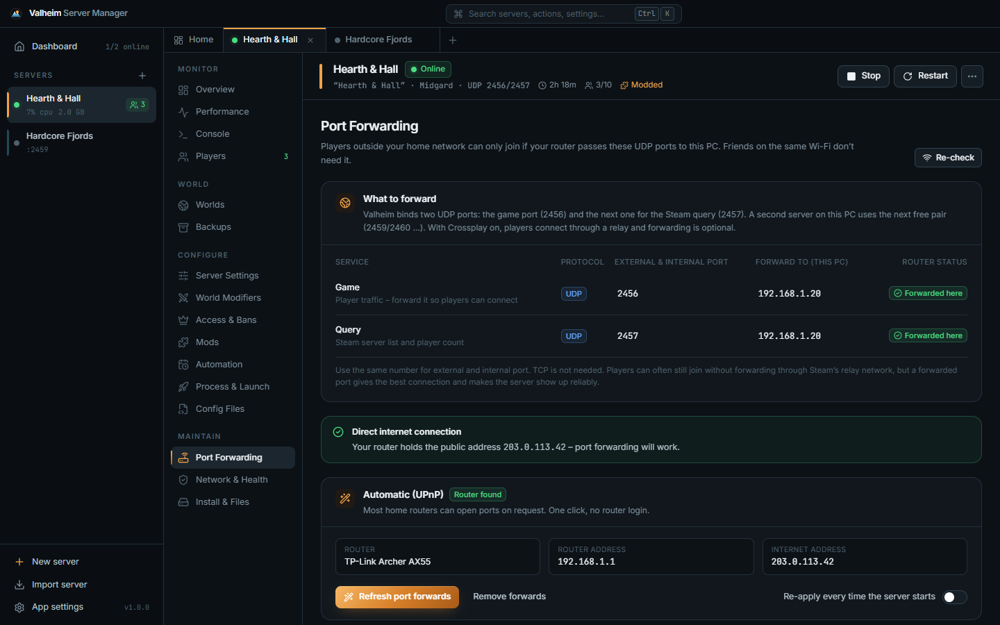 <br> **Port forwarding** – UPnP, firewall, Steam check |
| 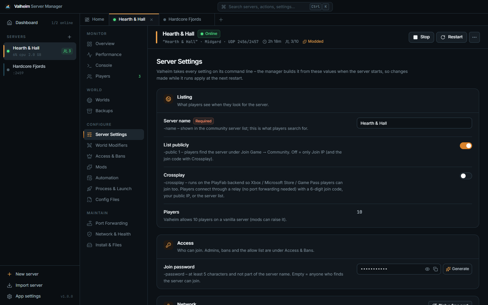 <br> **Server settings** – name, password, crossplay, saves | 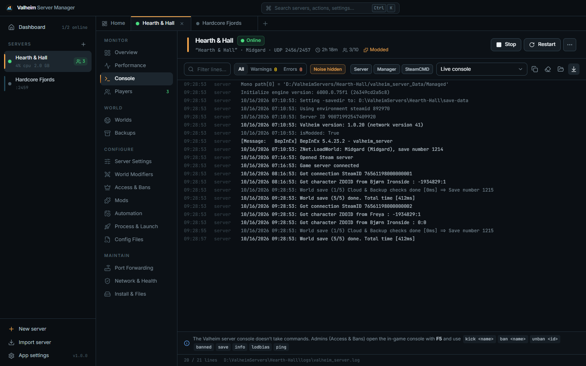 <br> **Console** – live log with noise filter |

## 🚀 Quick start

1. **Download** `Valheim-Server-Manager-Setup.exe` from the [latest release](https://github.com/clawdroppin/Valheim_ServerManager/releases/latest) and run it.
   *Windows SmartScreen may warn because the app isn't code-signed yet: **More info → Run anyway**.*
2. Click **New server** → name it → set a password (5+ characters, not part of the name) → pick a difficulty → **Create & install** (about 1 GB download).
3. Press **Start**. The world is ready within a minute.
4. For Steam friends outside your home network open **Port Forwarding** → *Forward ports automatically* and *Allow through firewall* – or turn on **Crossplay** and skip forwarding.
5. Friends open **Start Game → Join Game → Community**, search your server name and enter the password. The **Overview** has copy buttons for the address, join code and password.
6. Already playing a single-player world? **Worlds → Bring a world from the game** before the first start.

The full walkthrough – every screen explained – is in the **[User guide](docs/USER_GUIDE.md)**.

### Downloads

| File | What it is |
|---|---|
| `Valheim-Server-Manager-Setup.exe` | Installer (recommended) – data in `%APPDATA%\com.valheimservermanager.app` |
| `Valheim-Server-Manager.msi` | The same as an MSI package |
| `Valheim-Server-Manager-Portable.zip` | No install – unzip anywhere writable; all data stays next to the exe |
| `SHA256SUMS.txt` | Checksums to verify the downloads |

### Requirements

| | |
|---|---|
| **Windows** | 10 or 11, 64-bit (the WebView2 runtime ships with Windows) |
| **Disk** | about 2 GB per server plus worlds and backups |
| **Memory** | 4 GB minimum, 8 GB comfortable (more with many mods) |
| **Network** | two UDP ports per server – **2456/2457** by default (2459/2460 … for more servers); none with Crossplay |

## 🛠 Troubleshooting

| Problem | Fix |
|---|---|
| Nobody can find the server | **Network & Health → Steam server list**. If it's not listed: allow the firewall and forward UDP 2456–2457, or turn on Crossplay. After a game patch, update the server – players only see servers on their version. |
| “Incompatible version” | The game was updated: **Update server** (or turn on auto-update). Modded servers also need matching mod versions. |
| The server stops right after starting | The manager shows the server's error (e.g. *password too short*) and pauses auto-restart. Network & Health explains what to fix. |
| Xbox / Game Pass friends can't join | Turn on **Crossplay** under Server Settings and give them the join code from the Overview. |
| Mods don't load | Check **Mods → BepInEx log**. After a Valheim update, mods often need an update too (**Check for updates**). |
| “Stop the server first” | Rollbacks, renames, restores, resets and mod changes need the server stopped, because it has the files open. |
| Griefing or a bad mistake | **Worlds → Roll back** to one of the server's backups (a zip backup is made first). |

More answers in the [user guide's troubleshooting section](docs/USER_GUIDE.md#13-troubleshooting).

## 🔒 Good to know

- **Your data stays yours.** No accounts, no telemetry. The app only talks to Steam (SteamCMD, api.steamcmd.net for update checks, the public server list for the listing check), Thunderstore (only when you install or check mods), a public-IP lookup and your router (UPnP – only when you click).
- **Your router and firewall only change when you click** the buttons for it (or opt in to re-apply UPnP on start).
- **Characters stay with the players** – Valheim stores them on each player's PC; the server only holds the world.
- **The join password is on the server's command line** – Valheim has no other way to receive it. The manager masks it everywhere it shows the command line and encrypts it in its own files.

## 🧑‍💻 For developers & AI agents

Built with **Tauri 2** (Rust backend) and **React 19 + TypeScript + Tailwind CSS 4**.

```bash
npm install
npm run tauri dev        # full app with hot reload
npm run dev              # UI only, in a browser, with a mock backend
npm run build:all        # installer + MSI + portable zip
```

- **[AGENTS.md](AGENTS.md)** – architecture, repository map, facts verified against the real dedicated server, invariants and the release process. Start here (AI assistants: `CLAUDE.md` points to it).
- **[docs/USER_GUIDE.md](docs/USER_GUIDE.md)** – what every screen does, for users.
- **[CHANGELOG.md](CHANGELOG.md)** – release notes.
- **Website** source is `site/index.html`, published on the `gh-pages` branch (`node scripts/build-site.mjs`).

Development happens on the **`release`** branch (the default branch). Releases are built by GitHub Actions: pushing a `vX.Y.Z` tag publishes the installer, MSI, portable zip and checksums.

## 📄 License

[MIT](LICENSE) © clawdroppin. Valheim is a trademark of Iron Gate AB; this project is not affiliated with or endorsed by Iron Gate or Coffee Stain.
